# 原图不动 · 彩平生成

`cai-preserve-plan-color-render` 是一个面向室内平面图上色的 Agent Skill。上传原始平面图，查看五个分类、15 张视觉卡，回复编号，即可进入彩平生成或提示词输出流程。

**当前为实验版 v0.1.0。** “原图不动”是验收要求，不是图像模型已经达到的精度保证。实际测试中，04 和 11 仍出现细小标注、家具细线被重绘的情况，未通过完整保留验收。生成结果需要与原图人工核对；本项目不提供确定性的 CAD 锁线或自动像素保真功能。

## 安装

### 支持 Agent Skills 的工具

需要 Node.js 和 npm。在终端运行：

```bash
npx skills add xinnyu999/cai-preserve-plan-color-render
```

按安装器提示选择 Agent。只安装到当前项目的 Codex：

```bash
npx skills add xinnyu999/cai-preserve-plan-color-render --skill cai-preserve-plan-color-render --agent codex --yes
```

是否需要重新打开会话，取决于所用 Agent 的技能发现机制。

### 手动安装或其他 Agent

下载本仓库，或运行：

```bash
git clone https://github.com/xinnyu999/cai-preserve-plan-color-render.git
```

把包含 `SKILL.md`、`references/` 和 `assets/` 的完整目录放入目标 Agent 支持的 Skill 目录。目录名保持 `cai-preserve-plan-color-render`；不要只复制 `SKILL.md`，否则风格图册和检查规则会缺失。

不支持 Skill 安装的聊天工具，可读取本仓库的 `SKILL.md` 和对应参考文件来使用这套流程；这属于手动使用，不代表该工具支持自动安装。

## 使用

在 Codex 等支持 `$技能名` 的工具中输入：

```text
$cai-preserve-plan-color-render
```

或告诉 Agent：

```text
使用 cai-preserve-plan-color-render，把我上传的平面图转为彩平图。
```

1. 查看按 A–E 分类横向展示的 15 张视觉卡。
2. 上传完整、正视、线条与标注清楚的原始平面图。
3. 回复编号，例如 `04` 或 `11`；回复 `0` 则从适合的卡片中推荐。
4. Agent 生成一张测试稿，并按原图核对。出现结构、新增物或条带瑕疵时最多修正一次；仍失败应明确报告。

已经上传图纸或选好编号时，会跳过相应提问。无需另选配色，每张卡都绑定颜色、线条、材质、阴影和留白。

## 15 张风格卡

以下样张用于选择视觉方向，不是对任意输入图纸生成质量的承诺。

### A. 清透图纸

| 01 · 轻彩留白 | 02 · 精密线描构成 | 03 · 透明线框光影 | 04 · 低饱和扁平色块 |
| --- | --- | --- | --- |
| 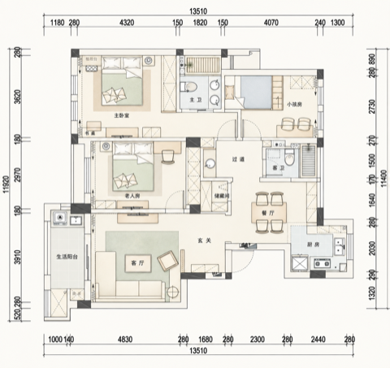 | 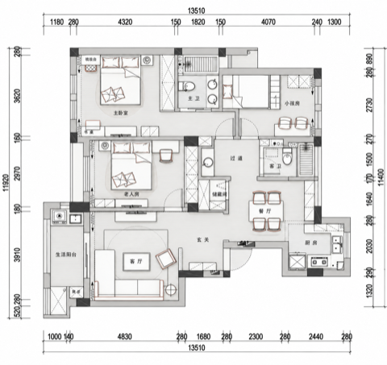 | 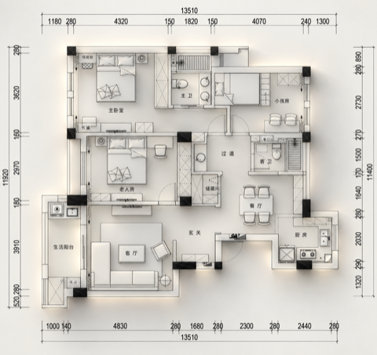 | 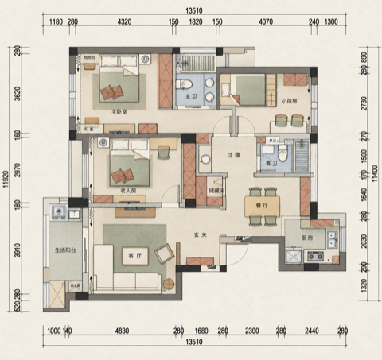 |

### B. 投影构成

| 05 · 灰阶投影构成 | 06 · 硬影黑白构成 |
| --- | --- |
| 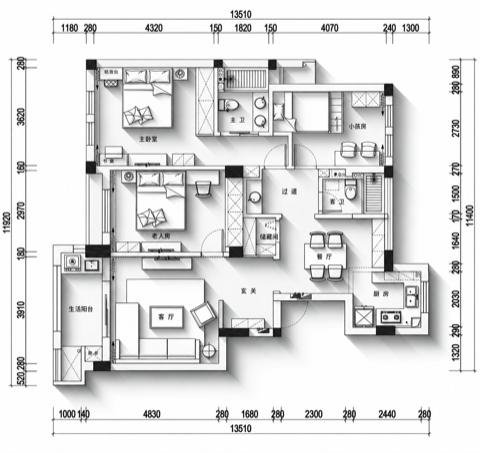 | 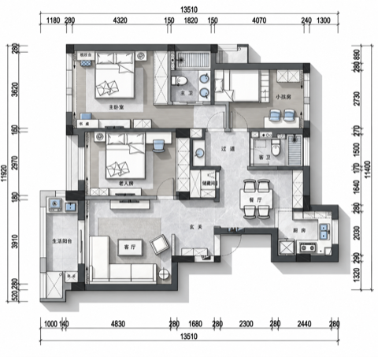 |

### C. 留白气氛

| 07 · 新中式卷轴 | 08 · 景观写实沙盘 | 09 · 雾白柔影绿植 | 10 · 版式纸感彩平 |
| --- | --- | --- | --- |
| 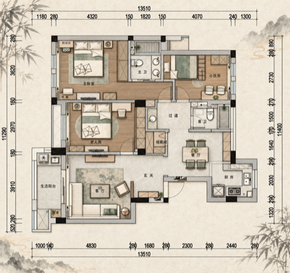 | 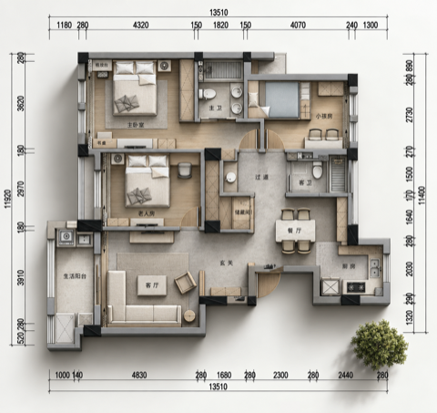 | 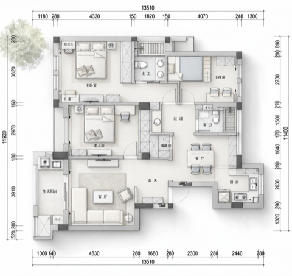 | 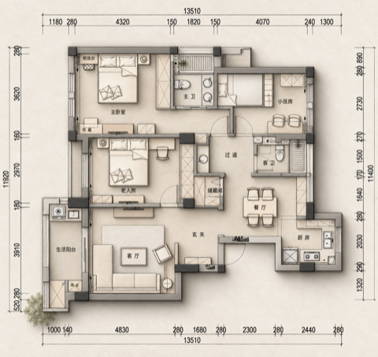 |

### D. 立体材质

| 11 · 深线材质图纸 | 12 · 白模空间浮雕 | 13 · 暖灰纸感浮雕 | 14 · 写实深阴影立体 |
| --- | --- | --- | --- |
| 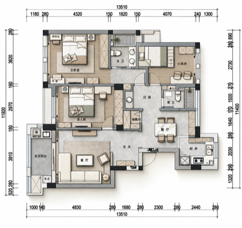 | 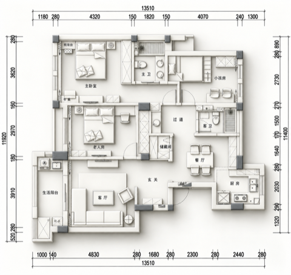 | 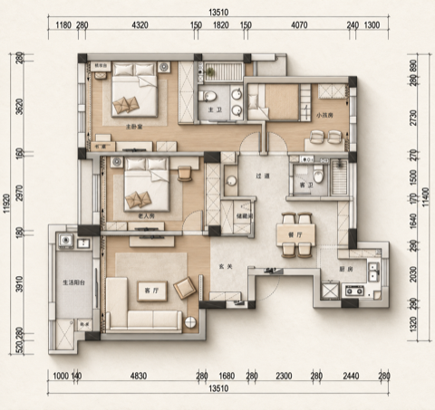 | 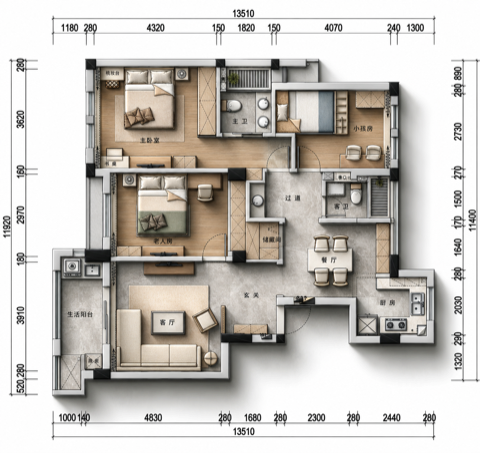 |

### E. 手绘表达

| 15 · 松弛马克笔手绘 |
| --- |
| 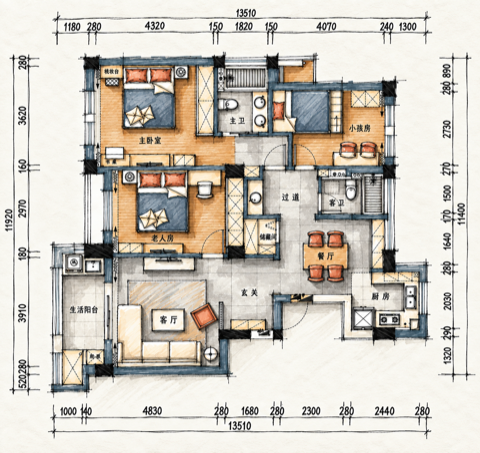 |

## 能力与边界

- 核心指令与图像模型无关，`agents/openai.yaml` 是可选的 Codex 界面适配文件。
- 直接出图需要 Agent 能读取图片并调用图像编辑工具；图像服务的账号、费用及条款由该工具提供方决定。本仓库不附带 API 密钥或图像模型。
- 无图像编辑能力时，只能输出完整提示词。无法展示本地图片时，应显示名称和编号并说明限制。
- 墙体、门窗、家具、尺度、房间分区及标注均须保留。平面内不得增加物件；只有 07、08、09 允许在规定的图外留白增加绿植。
- 细小文字、密集线条及高立体表现存在重绘风险。发现偏差应报告，不能仅凭风格相似声称通过验收。
- 本项目不替代施工图、尺寸核验或设计师审核，也没有完成所有 Agent、所有风格的端到端兼容性验证。

## 文件与复查

```text
SKILL.md                       Agent 入口与工作流程
references/style-cards.md      15 张完整视觉卡
references/style-card-gallery.md  首屏图册与资产索引
references/quality-check.md    原图对照与失败处理
assets/style-previews/         15 张风格预览
agents/openai.yaml             可选 Codex 界面元数据
scripts/validate.py            无第三方依赖的打包检查
LICENSE                       MIT 开源许可
ASSET_NOTICE.md               演示图说明
```

检查文件、编号、图片及本地链接：

```bash
python3 scripts/validate.py
```

该检查只验证包的完整性，不验证图像生成效果。欢迎通过 [Issues](https://github.com/xinnyu999/cai-preserve-plan-color-render/issues) 或 Pull Request 提交问题和改进。反馈生成问题时，注明 Agent、图像工具、风格编号及具体偏差；仅上传你有权公开的图纸，并先移除项目隐私。

## 开源许可

采用 [MIT License](LICENSE)。演示素材的说明见 [ASSET_NOTICE.md](ASSET_NOTICE.md)。
